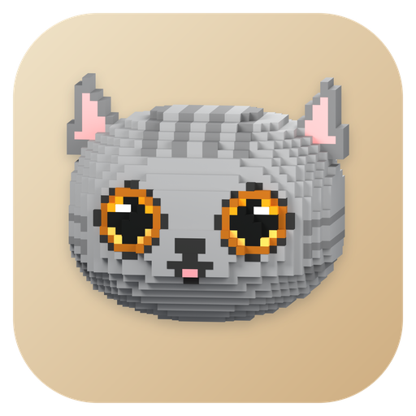

# CatCommStudio 品牌素材

**基础 Logo 已定版，底色按最新指示更新为暖沙色：暖沙圆角矩形底座 + CatGray 原模型猫头。** 无角标基础版位于 `final/`；Launcher 与九个通信子程序的扩展图标位于 `extensions/`，包含新增的 CAN。

- [定版素材与规范](final/README.md)
- [2048 px PNG](final/png/catcommstudio-2048.png)
- [Windows ICO](final/catcommstudio.ico)
- [组合 SVG](final/catcommstudio.svg)
- [颜色与布局参数](final/palette.json)
- [Launcher 与通信子程序图标](extensions/README.md)
- [十个扩展图标总览](extensions/overview.png)

定版所需的猫头模型、透明渲染图、导出脚本和空白角标模板均在 `final/` 内。`extensions/` 是用户已确认的模块图标；基础定版与扩展分别维护。

## QCatUiKit 专用设计

[QCatUiKit Logo 提案](qcat-uikit/README.md) 沿用 CatGray 灰猫，使用蓝色底座与 UI 组件网格角标。提供完整 SVG、10 种尺寸 PNG、Windows ICO 与[设计总览](qcat-uikit/overview.png)。所有尺寸统一使用完整灰猫与组件角标。用户已选择该设计方向，具体构图仍为待审阅提案。
