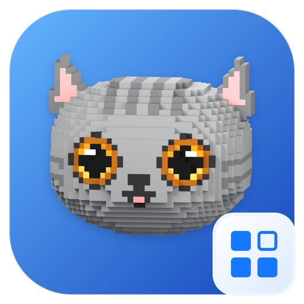

# QCatUiKit 专用 Logo

**状态：设计提案。** 用户于 2026-10-11 选择“沿用现有灰猫，做蓝色 UI 组件库版本”的方向；本目录为该方向的首版设计，具体构图尚待审阅。



[查看设计总览](overview.png) · [查看实际尺寸及深浅背景效果](size-review.png)

## 设计

沿用 CatGray 的体素灰猫模型、灰色毛发、金色眼睛、粉色内耳与原表情。蓝色圆角底座区分 QCatUiKit 的组件库身份；右下角的圆角网格代表可组合的界面控件，其中一个空心格表达不同组件状态。

- 主色取自 QCatUiKit 的 `ThemePalette::Impl::primary`：`#1677FF`。
- 底座使用 `#64B5FF → #1545BA` 的蓝色渐变。
- 网格角标使用白色至浅蓝色底面、浅色边缘与 `#1677FF` 符号。
- 沿用 512 × 512 的基础画布，底座位于 `(16, 16)`，尺寸为 `480 × 480`，圆角半径为 `104`。
- 猫头与阴影的图像数据及位置保持原样；组件角标位于 `(358, 358)`，尺寸为 `140 × 140`，外圆角半径为 `36`。

## 使用文件

| 文件 | 用途 |
| --- | --- |
| [qcat-uikit.svg](qcat-uikit.svg) | 完整图标；底座与角标可编辑，猫头和阴影是内嵌 PNG |
| [qcat-uikit.ico](qcat-uikit.ico) | Windows 应用图标，含 16、24、32、48、64、128、256 px |
| [2048 px PNG](png/qcat-uikit-2048.png) | 高清完整图标，圆角外透明 |
| `png/qcat-uikit-{尺寸}.png` | 16、24、32、48、64、128、256、512、1024、2048 px 的 RGBA PNG |
| [overview.png](overview.png) | 完整图标、名称组合示意与深浅背景效果 |
| [size-review.png](size-review.png) | 实际尺寸对照 |
| [palette.json](palette.json) | 配色、布局、素材来源与设计状态 |
| [generate.py](generate.py) | 生成 SVG、PNG、ICO 与预览，执行导出校验 |

所有 PNG 尺寸及 ICO 对应帧统一使用完整体素灰猫、蓝色底座与组件网格角标，均由同一完整 SVG 导出。

本目录为 QCatUiKit 的专用设计；CatCommStudio 的 `final/` 和 `extensions/` 继续使用各自已确认的素材。此处提供可用于 QCatUiKit 的资源，应用资源注册、窗口图标与 Gallery 接入另行执行。

## 维护与验证

在 CatCommStudio 仓库根目录执行：

```powershell
python assets/brand/qcat-uikit/generate.py
```

依赖 Python 3.10+、Pillow，以及 PATH 中带 SVG 渲染支持的 ImageMagick `magick`。预览文字使用本机 Microsoft YaHei、Segoe UI 或 Noto Sans CJK；Logo 的 SVG 无需字体。生成时从 `../final/catcommstudio.svg` 读取原猫头和阴影；生成后的 SVG 自包含，可直接复制到使用项目。图像链接采用 SVG 1.1 的 `xlink:href`，兼容本次使用的 SVG 渲染器。

本次已执行生成脚本并检查两张预览：10 个 PNG 的尺寸、RGBA 模式、四角透明，ICO 的七个尺寸与对应 PNG 像素一致性，原猫头及阴影的图像数据与布局一致性，以及原基础 SVG 的 SHA-256 均通过校验。额外检查完整 PNG 中猫头确实渲染。未在 QCatUiKit 应用内验证资源接入。
