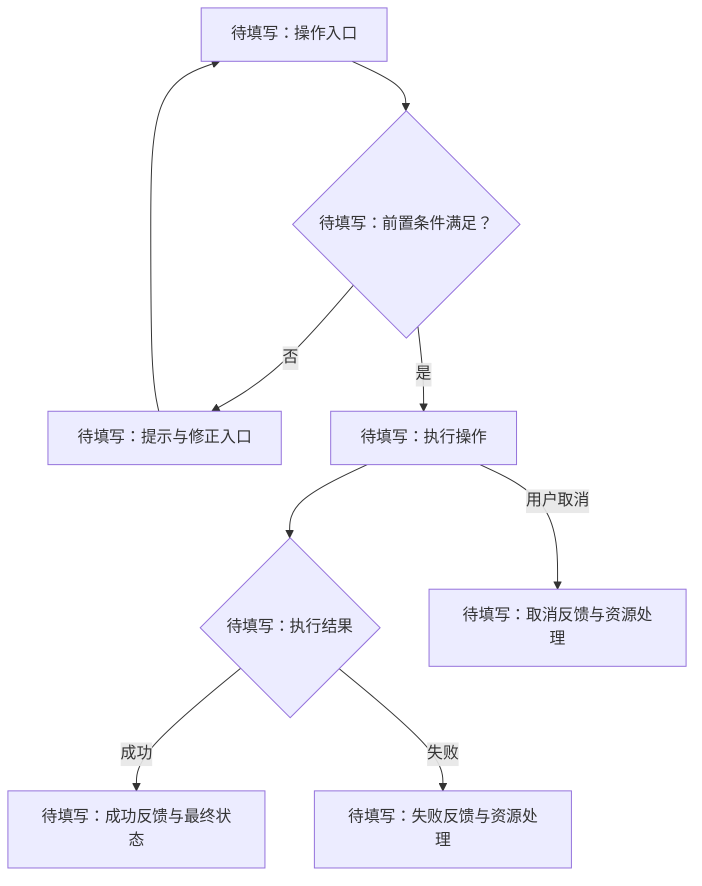
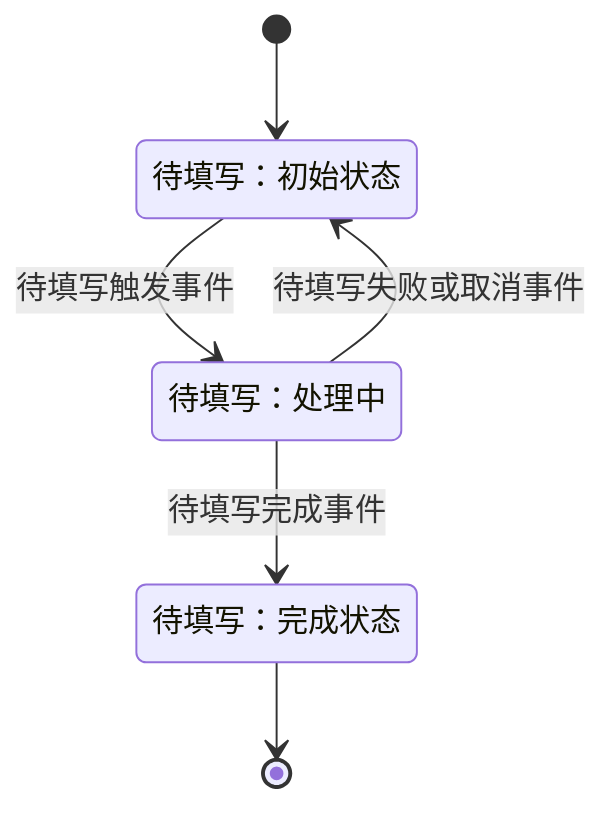

# 流程模板

使用方法：复制为具体流程文件，替换编号、占位文字与 Mermaid 节点。图示只是填写骨架，不代表已确认的产品行为。简单操作可直接写在需求中；独立流程必须关联需求依据。

## FLOW-{MODULE}-{NNN}：{流程名称}

| 字段 | 内容 |
| --- | --- |
| 设计状态 | 待确认 |
| 关联需求 | 待填写需求编号与相对链接 |
| 参与者 | 待填写用户、进程、模块或设备 |
| 起始条件 | 待填写状态、权限及输入 |
| 完成条件 | 待填写成功、失败及取消时的终止条件 |

### 正常与异常路径

### 步骤说明

| 图中节点 | 触发者与输入 | 系统处理 | 可见反馈 | 需求依据 |
| --- | --- | --- | --- | --- |
| 待填写 | 待填写 | 待填写 | 待填写 | 待填写 |

### 状态转换（按需保留）

以下为抽象状态示例，正式文档应使用业务状态名，并补齐每种事件的处理规则。

### 异常和恢复规则

| 事件 | 原状态 | 后续状态 | 提示与恢复入口 | 资源与未完成操作的处理 |
| --- | --- | --- | --- | --- |
| 待填写 | 待填写 | 待填写 | 待填写 | 待填写 |

按场景检查超时、重复操作、设备移除、远端断开、子进程退出和迟到结果；不适用的情况说明原因。需要重试时，明确是否可能重复执行设备操作。

### 待确认问题

- 待填写，并说明对应图节点或状态转换。
