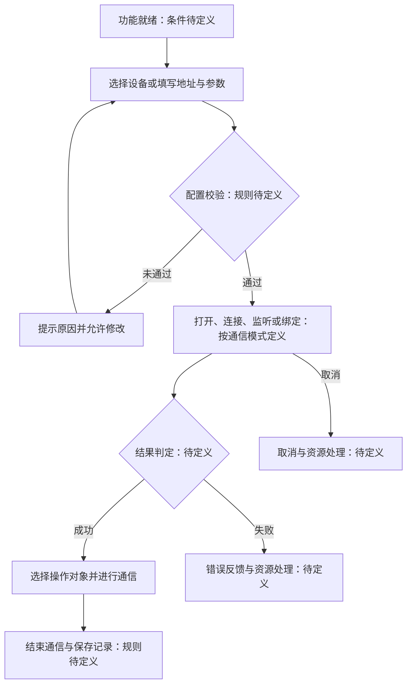

# 连接与通信操作流程

状态：流程填写入口。产品定义提供了建议验证的用户场景，本文尚未形成逐项确认的流程规范。关联需求编号待分配，图示仅为候选流程骨架。

依据：[产品定义](../product-definition.md)、[通信能力映射](../communication-capabilities.md)。填写方式见[流程模板](_template.md)。

## 1. 场景与前置条件

- 通信类型与模式：待确认。
- 关联需求：待填写编号与链接。
- 起始条件：待填写功能就绪、设备、权限与配置要求。
- 完成条件：待填写成功、失败与取消时的最终状态。

## 2. 候选流程骨架

## 3. 各通信模式需要明确的差异

| 场景 | 需要填写的规则 |
| --- | --- |
| 串口 | 打开与关闭、参数校验、端口占用和拔出 |
| TCP 客户端与服务端 | 连接、监听、客户端选择及远端断开 |
| UDP | 本地绑定、目标地址、来源地址；不套用 TCP 已连接状态 |
| BLE | 扫描、连接、服务与特征发现、读写和订阅 |
| USB 与 HID | 设备打开、接口或报告选择、传输结果和设备移除 |

WebSocket、MQTT 在明确范围后再补充对应流程。各模式可按需拆成独立文件并分配流程编号。

## 4. 异常与恢复

| 事件 | 当前状态与反馈 | 下一步操作 | 数据与资源处理 | 需求依据 |
| --- | --- | --- | --- | --- |
| 待填写：按模式选择具体异常 | 待填写 | 待填写 | 待填写 | 待填写 |

需要覆盖的情况按适用性选择：找不到设备、权限不足、占用、超时、设备移除、远端断开、格式错误、取消、子进程退出。恢复配置、重新建立通信、重新发送数据应分别定义，不能默认等同。

## 5. 待确认问题

- 每种模式的成功判定、状态名称与取消时机是什么？
- 失败后保留哪些配置和记录，哪些资源需要释放？
- 哪些场景允许重试或自动恢复，如何避免重复发送？
